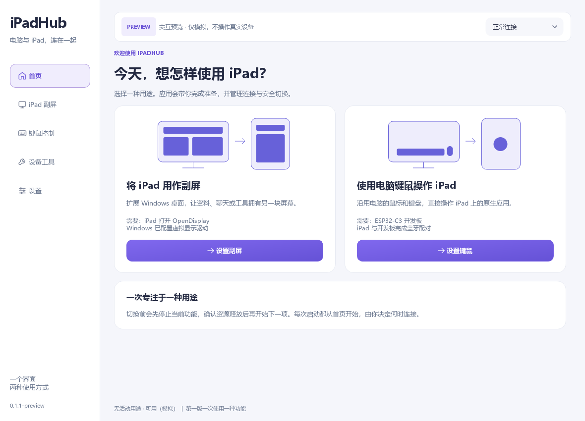

# iPadHub

[简体中文](README.md) | English

**iPad extended display and keyboard/mouse control in one Windows app.**

Use an iPad as a second screen over USB or Wi-Fi, or control its native apps with your PC's keyboard and mouse through an ESP32-C3 bridge.

Current release: **0.1.1-preview**. [Download](https://github.com/tukitohosi/ipad-hub/releases/tag/v0.1.1-preview)

The screenshot is an isolated interactive preview without personal device information.

## Changes in 0.1.1-preview

- The Display page places the extended desktop to the left or right below the connection method. This is separate from the keyboard/mouse entry edge. Moving a window across the real displays was checked locally.
- Quality presets target 60 fps at 15 / 30 / 45 Mbps. Existing custom settings are retained; switching quality during a session reconnects the same iPad. A real Wi-Fi session used custom 60 fps / 100 Mbps settings; these are targets, not measured throughput or frame rate.
- Mouse capture and sending run separately. A new speed wizard samples slow, normal and fast movements. **The tested matching feel did not meet expectations, and the 10% physical-distance-error target remains unverified.** The wizard remains experimental.

See the [release report](docs/releases/0.1.1-preview.md) for validation scope and limits.

## Features

| Mode | Features | Requirements |
| --- | --- | --- |
| Extended display | USB and Wi-Fi, device discovery, quality presets | OpenDisplay on the iPad and a Windows virtual display driver; Apple device services for USB |
| Keyboard and mouse | Native iPad app control, left/right placement, free/locked switching and speed adjustment | A compatible ESP32-C3 connected to the PC by USB and paired with the iPad |
| Device tools | Firmware backup, flashing and restoration | A compatible board and USB data cable |

The current release runs one mode at a time. Switching stops the current mode and releases its devices before starting the next.

## Download and use

Get the Windows x64 installer or portable ZIP from the [release page](https://github.com/tukitohosi/ipad-hub/releases/tag/v0.1.1-preview). Extract the entire portable folder before opening iPadHub.exe. The release also includes the matching source ZIP and checksum lists.

The installer is unsigned. Install the display driver and iPad receiver separately; the installer does not change firewall rules.

The home page does not connect automatically or capture input. Closing the window minimizes to the tray; quitting stops the backend. Press **Ctrl + Alt + Esc** to return keyboard and mouse control to Windows in an emergency.

## Data and limitations

Compatible legacy settings and firmware backups are copied into the current user's LocalAppData/iPadHub folder. MouseLink and iPad互联 can remain installed; quit iPadHub before using them with the same devices. Uninstalling keeps user data by default.

- This integration preview cannot run both modes at once.
- OpenDisplay must stay in the foreground for extended display.
- Keyboard/mouse control requires the compatible ESP32-C3; the PC's own Bluetooth is not a substitute.
- Keep USB connected during firmware operations.

## Development and license

See the [build instructions](docs/packaging.md). The exact corresponding source for the binaries is the Release asset `iPadHub-0.1.1-preview-source.zip`; the repository additionally contains publishing documentation. The combined product provides source under [GPL-3.0](LICENSE); components retain their original licenses. See [third-party notices](THIRD_PARTY_NOTICES.md).
